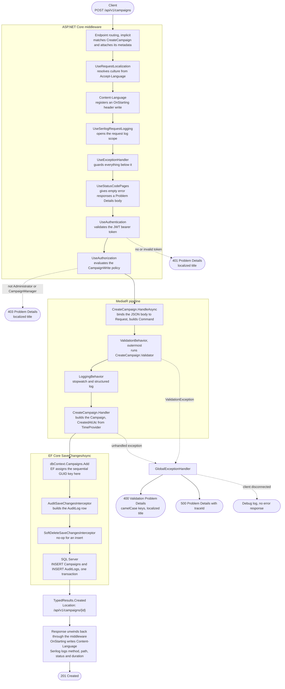
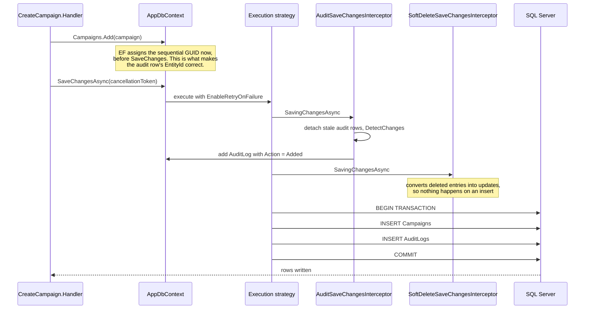

# Request pipeline

This traces one request, `POST /api/v1/campaigns`, from the client to `201 Created`, naming every
steps it passes through. [Basic Architecture](basic-architecture.md) summarises the same path in
five lines; this document is the detailed version.

Every other endpoint follows the same shape. Only the slice at the centre changes.

## Full request lifecycle

## Inside SaveChangesAsync

Interceptor ordering and transaction boundaries are the part most easily got wrong, so they get
their own view.

## Steps

| Step | Source |
|---|---|
| Endpoint routing (implicit) | added by `WebApplication` before the middleware in [Program.cs](../src/DotNetBackendTemplate.Api/Program.cs) |
| Request localization | [Program.cs](../src/DotNetBackendTemplate.Api/Program.cs), configured in [ServiceCollectionExtensions.cs](../src/DotNetBackendTemplate.Api/Common/Extensions/ServiceCollectionExtensions.cs) |
| Content-Language | inline middleware in [Program.cs](../src/DotNetBackendTemplate.Api/Program.cs) |
| Serilog request logging | [Program.cs](../src/DotNetBackendTemplate.Api/Program.cs) |
| Exception handling | [GlobalExceptionHandler.cs](../src/DotNetBackendTemplate.Api/Common/Exceptions/GlobalExceptionHandler.cs) |
| Status code pages | [Program.cs](../src/DotNetBackendTemplate.Api/Program.cs), titles localized in [ServiceCollectionExtensions.cs](../src/DotNetBackendTemplate.Api/Common/Extensions/ServiceCollectionExtensions.cs) |
| Authentication | [AuthenticationExtensions.cs](../src/DotNetBackendTemplate.Api/Infrastructure/Authentication/AuthenticationExtensions.cs) |
| Authorization policy | [AuthorizationPolicies.cs](../src/DotNetBackendTemplate.Api/Infrastructure/Authorization/AuthorizationPolicies.cs) |
| Route group and endpoint mapping | [EndpointRouteBuilderExtensions.cs](../src/DotNetBackendTemplate.Api/Common/Extensions/EndpointRouteBuilderExtensions.cs) |
| Endpoint, validator and handler | [CreateCampaign.cs](../src/DotNetBackendTemplate.Api/Features/Campaigns/CreateCampaign.cs) |
| Validation behavior | [ValidationBehavior.cs](../src/DotNetBackendTemplate.Api/Common/Behaviors/ValidationBehavior.cs) |
| Logging behavior | [LoggingBehavior.cs](../src/DotNetBackendTemplate.Api/Common/Behaviors/LoggingBehavior.cs) |
| Audit interceptor | [AuditSaveChangesInterceptor.cs](../src/DotNetBackendTemplate.Api/Persistence/Auditing/AuditSaveChangesInterceptor.cs) |
| Soft-delete interceptor | [SoftDeleteSaveChangesInterceptor.cs](../src/DotNetBackendTemplate.Api/Persistence/SoftDelete/SoftDeleteSaveChangesInterceptor.cs) |
| DbContext and query filters | [AppDbContext.cs](../src/DotNetBackendTemplate.Api/Persistence/AppDbContext.cs) |

## Orderings that are easy to get wrong

- **Routing runs before the middleware listed in `Program.cs`.** `WebApplication` inserts endpoint
  routing at the front of the pipeline. That is why `UseAuthorization` can evaluate the endpoint's
  `CampaignWrite` policy: the endpoint has already been matched and its metadata attached.
- **`ValidationBehavior` wraps `LoggingBehavior`, not the other way round.** They are registered in
  that order and MediatR makes the first registration outermost, so a `ValidationException` never
  reaches `LoggingBehavior`. Validation failures are therefore not timed or logged by it — they
  surface through `GlobalExceptionHandler` instead.
- **`UseExceptionHandler` is registered after `UseSerilogRequestLogging`.** The request is still
  logged with its final status when the exception handler produces the response.
- **`UseStatusCodePages` sits before authentication.** A 401 challenge, a 403 forbid, and an empty 404 therefore
  get a Problem Details body with a localized title on the way out, and the `WWW-Authenticate` header is kept.
- **`Content-Language` is written from `OnStarting`, not eagerly.** `UseExceptionHandler` clears
  response headers when it re-executes the pipeline, so a header written earlier would be lost on
  every error response.
- **The entity key is assigned by `Add`, not by `SaveChanges`.** EF's sequential GUID generator runs
  when the entity is tracked, which is what lets the audit interceptor record a real `EntityId`
  while still inside `SavingChanges`. See [ADR-0006](adr/0006-use-sequential-guid-keys.md).
- **The business row and its audit row commit together.** Both interceptors run inside the retrying
  execution strategy, and both inserts share one transaction. See
  [ADR-0002](adr/0002-persist-audit-logs-with-ef-core-interceptor.md).
- **A cancelled request is not a `500`.** When the client disconnects, `GlobalExceptionHandler`
  recognises the `OperationCanceledException`, logs at debug level, and writes no error response.
